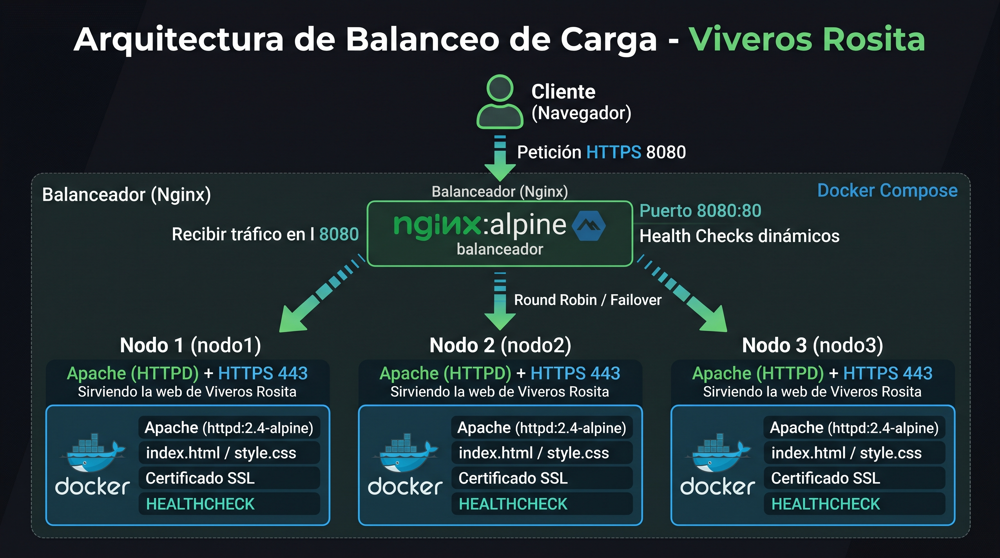

#  Plataforma Web para "Viveros Rosita"

Landing page de promoción para **Viveros Rosita**, empaquetada con **Docker**, servida por **Apache con HTTPS** en **3 nodos** y distribuida en un **clúster con balanceador de carga Nginx (Round Robin + health checks)**, para mantenerse estable incluso en temporadas de alta demanda.

> **Tipo de proyecto:** Negocio real

---

##  Tabla de contenidos

1. [Equipo](#equipo)
2. [Descripción del proyecto](#descripción-del-proyecto)
3. [Arquitectura](#arquitectura)
4. [Nodos del clúster](#nodos-del-clúster)
5. [Balanceador de carga (Nginx)](#balanceador-de-carga-nginx)
6. [SSL, certificados y llaves](#ssl-certificados-y-llaves)
7. [Red y puertos](#red-y-puertos)
8. [Tecnologías](#tecnologías)
9. [Estructura del proyecto](#estructura-del-proyecto)
10. [Requisitos previos](#requisitos-previos)
11. [Instalación y ejecución local](#instalación-y-ejecución-local)
12. [Despliegue en VM con Tailscale](#despliegue-en-vm-con-tailscale)
13. [Verificación y pruebas del clúster](#verificación-y-pruebas-del-clúster)
14. [Solución de problemas](#solución-de-problemas)
15. [Alcance por unidad](#alcance-por-unidad)

---

##  Equipo

| Integrante |
|---|
| Oscar Stanley Marquez Portillo |
| Kevin Alejandro Granillo Soto |
| Kennet Jared Mejia Portillo |
| Anderson Isaac Ortiz Canizález |
| José Aristides Zelaya Parada |
| Diana Damary García Ambrosio |

---

##  Descripción del proyecto

### ¿A quién ayuda el sitio?

A los administradores de Viveros Rosita y a sus clientes. Ayuda a los dueños a promocionar sus productos y especies botánicas, y a los clientes a conocer y ver las flores, plantas y suministros de jardinería que ofrece el vivero.

### ¿Qué problema concreto resuelve?

Resuelve la falta de visibilidad digital del vivero. Actualmente, los clientes deben visitar el local para conocer los productos y flores disponibles.

El sitio es una landing page de promoción que presenta los productos de forma atractiva y, gracias a la infraestructura en clúster, se mantiene **estable y disponible** incluso ante picos de tráfico en temporadas de alta demanda (como el Día de la Madre o la primavera).

---

##  Arquitectura





### Flujo de una petición

1. El cliente entra por HTTPS al balanceador (`lb`).
2. Nginx elige un nodo sano con **Round Robin** y le reenvía la petición por HTTPS (puerto 443 interno).
3. El nodo (Apache) responde con la landing page.
4. Nginx devuelve la respuesta al cliente e incluye el encabezado `X-Nodo`, que indica qué nodo atendió la petición.


### Componentes

- **Sitio web:** landing page de una sola página (`web/index.html`, con los estilos incluidos en el propio HTML), enfocada en promocionar productos y mostrar flores.
- **Contenedor / imagen Docker:** `web/Dockerfile` empaqueta Apache, el sitio y los certificados en una única imagen llamada `vivero-rosita`. Así el sitio funciona igual en cualquier equipo y se pueden crear copias idénticas rápidamente, que es la base para levantar varios nodos.
- **Servidor web y HTTPS:** cada nodo ejecuta **Apache** con HTTPS (puerto 443) usando el certificado de `web/certs/`.
- **Clúster:** `docker-compose.yml` levanta **3 nodos** (`nodo1`, `nodo2`, `nodo3`) y el balanceador `lb`.
- **Balanceador:** Nginx reparte la carga entre los nodos y deja de enviar tráfico a los que no estén sanos.

---

## Nodos del clúster


| Servicio | Hostname | IP interna    | Puerto expuesto (solo host local) | Descripción                                   |
| -------- | -------- | ------------- | --------------------------------- | --------------------------------------------- |
| `nodo1`  | `nodo1`  | `172.29.0.11` | `127.0.0.1:9005 → 443`            | Construye la imagen `vivero-rosita` (`build: ./web`) |
| `nodo2`  | `nodo2`  | `172.29.0.12` | `127.0.0.1:9006 → 443`            | Reutiliza la imagen `vivero-rosita`           |
| `nodo3`  | `nodo3`  | `172.29.0.13` | `127.0.0.1:9007 → 443`            | Reutiliza la imagen `vivero-rosita`           |

- Solo `nodo1` define `build`; los otros dos usan la **misma imagen ya construida**, por lo que los 3 nodos son idénticos.
- Cada nodo tiene una **IP fija** dentro de la red `clusternet`, lo que permite a Nginx referenciarlos de forma estable.
- Los puertos `9005`, `9006` y `9007` están publicados **solo en `127.0.0.1`**: sirven para depurar un nodo directamente desde el host/VM y **no son accesibles desde fuera**.
- El tráfico real de los usuarios nunca va directo a un nodo: siempre pasa por `lb`.
- Los nodos incluyen health check; Docker los marca como `healthy` cuando responden correctamente (se ve con `docker compose ps`).

---

## Balanceador de carga (Nginx)

- **Imagen:** `nginx:alpine`.
- **Configuración:** `nginx/nginx.conf`, montada en modo solo lectura en `/etc/nginx/nginx.conf`.
- **Certificados:** `web/certs/` se monta en solo lectura en `/etc/nginx/certs`, por lo que el balanceador usa el mismo par certificado/llave que los nodos.
- **Algoritmo:** Round Robin: las peticiones se reparten por turnos entre `172.29.0.11:443`, `172.29.0.12:443` y `172.29.0.13:443`.
- **Health checks (dos niveles):**
  - Docker comprueba la salud de cada nodo, y `lb` **no arranca hasta que los 3 nodos estén `healthy`** (`depends_on` con `condition: service_healthy`).
  - Si un nodo cae en ejecución, Nginx deja de enviarle tráfico y redistribuye entre los nodos activos.
- **Encabezado `X-Nodo`:** permite ver qué nodo respondió cada petición (útil para demostrar el balanceo).
- **`server_name`:** en modo Tailscale se habilita `server_name 100.109.236.53;` en `nginx.conf` (ver [Despliegue en VM con Tailscale](#despliegue-en-vm-con-tailscale)).
- **Solo HTTPS:** el balanceador solo publica el puerto 443; el puerto 80 (HTTP plano) está cerrado.

---

## SSL, certificados y llaves

El proyecto usa HTTPS con un **certificado autofirmado / local**, apto para desarrollo y pruebas (no emitido por una CA pública).

| Archivo                | Qué es                                   | Dónde se usa                                                        |
| ---------------------- | ---------------------------------------- | ------------------------------------------------------------------- |
| `web/certs/server.crt` | Certificado público                      | Apache (cada nodo, empaquetado en la imagen) y Nginx (montado en `lb`) |
| `web/certs/server.key` | **Llave privada** correspondiente        | Apache (cada nodo) y Nginx                                          |

**Cómo se usan:**

- **En los nodos:** `web/Dockerfile` copia `server.crt` y `server.key` dentro de la imagen `vivero-rosita` durante el `build`. Por eso, **si regeneras los certificados debes reconstruir la imagen** (`--build`) para que los 3 nodos tomen los nuevos.
- **En el balanceador:** la carpeta `web/certs/` se monta como volumen de solo lectura; no requiere reconstruir imagen, solo recrear el contenedor.
- **Cadena completa cifrada:** cliente → Nginx (HTTPS) y Nginx → nodos Apache (HTTPS, puerto 443).

**Generar el certificado (elige una opción):**

*Opción A: mkcert (recomendada: el navegador confía en el certificado y no muestra advertencia).*

```bash
mkdir -p web/certs
mkcert -install        # una sola vez por equipo
mkcert -cert-file web/certs/server.crt -key-file web/certs/server.key localhost 127.0.0.1
```

*Opción B: OpenSSL (autofirmado; el navegador mostrará advertencia).*

```bash
mkdir -p web/certs
openssl req -x509 -nodes -days 365 -newkey rsa:2048 \
  -keyout web/certs/server.key \
  -out web/certs/server.crt \
  -subj "/CN=localhost" \
  -addext "subjectAltName=DNS:localhost,IP:127.0.0.1"
```

> **El certificado debe incluir cada nombre/IP desde el que se accederá al sitio** (`localhost`, `127.0.0.1` y, si aplica, la IP de Tailscale). Si falta uno, el navegador marcará error de certificado.

---

## Red y puertos

- **Red Docker:** `clusternet`, subred `172.29.0.0/24`. Los nodos tienen IP fija (`.11`, `.12`, `.13`); `lb` obtiene una IP dinámica de la misma red.
- **Puertos publicados:**

| Servicio | Puerto en el host                                            | Uso                                              |
| -------- | ------------------------------------------------------------ | ------------------------------------------------ |
| `lb`     | `8088 → 443` (modo local, por defecto)                       | Acceso al sitio: `https://localhost:8088`        |
| `lb`     | `100.109.236.53:443 → 443` (modo Tailscale, descomentado)    | Acceso al sitio: `https://100.109.236.53`        |
| `nodo1`  | `127.0.0.1:9005 → 443`                                       | Depuración directa (solo host)                   |
| `nodo2`  | `127.0.0.1:9006 → 443`                                       | Depuración directa (solo host)                   |
| `nodo3`  | `127.0.0.1:9007 → 443`                                       | Depuración directa (solo host)                   |

---

##  Tecnologías

| Tecnología | Uso |
|---|---|
| HTML5 / CSS3 | Landing page (`index.html`, `style.css`) |
| Apache HTTP Server | Servidor web de cada nodo |
| mkcert / OpenSSL | Generación del certificado autofirmado y la llave |
| Docker | Contenedorización del sitio, Apache y certificados |
| Docker Compose | Orquestación del clúster (3 nodos + balanceador + red) |
| Nginx | Balanceador de carga Round Robin, TLS y health checks |
| Tailscale | Acceso privado a la VM por IP `100.x.x.x` (despliegue remoto) |

---

##  Estructura del proyecto

> Estructura sugerida; ajústala a la organización real del repositorio.

```
Vivero-Rosita/
├── docker-compose.yml     # Define nodo1-3, lb (Nginx) y la red clusternet
├── tailscale.md           # Guía de despliegue en VM con Tailscale, pruebas y troubleshooting
├── .gitignore
├── README.md
├── img/
│   └── diagrama.jpeg      # Diagrama de arquitectura
├── nginx/
│   └── nginx.conf         # Balanceo Round Robin, TLS, health checks, X-Nodo
└── web/
    ├── Dockerfile         # Imagen vivero-rosita: Apache + sitio + certificados
    ├── index.html         # Landing page (estilos incluidos)
    └── certs/
        ├── server.crt     # Certificado (se genera localmente)
        └── server.key     # Llave privada (se genera localmente, no compartir)
```

---

##  Requisitos previos

- [Docker](https://docs.docker.com/get-docker/) (v20.10 o superior)
- [Docker Compose](https://docs.docker.com/compose/install/) (v2 o superior)
- Git
- [mkcert](https://github.com/FiloSottile/mkcert) (recomendado) u OpenSSL, para generar el certificado
- [Tailscale](https://tailscale.com/) (solo para el despliegue remoto en VM)

---

## Instalación y ejecución local

### 1. Clonar el repositorio

```bash
git clone https://github.com/KenDev2105/Vivero-Rosita.git
cd Vivero-Rosita
```

### 2. Generar el certificado y la llave

Ver [SSL, certificados y llaves](#ssl-certificados-y-llaves). Deben quedar `web/certs/server.crt` y `web/certs/server.key`.

### 3. Construir y levantar el clúster

```bash
docker compose up -d --build
```

### 4. Acceder al sitio

```
https://localhost:8088
```

> Con mkcert (tras `mkcert -install`) el navegador confía en el certificado. Con OpenSSL autofirmado verás una advertencia de seguridad: es lo esperado en local, acepta la excepción para continuar.

### 5. Detener el clúster

```bash
docker compose down
```

---

## Despliegue en VM con Tailscale

Para exponer el sitio directamente en `https://100.109.236.53` (IP de Tailscale de la VM). Guía completa en [`tailscale.md`](tailscale.md). Resumen:

**1. Regenerar el certificado incluyendo la IP de Tailscale:**

```bash
mkcert -cert-file web/certs/server.crt -key-file web/certs/server.key localhost 127.0.0.1 100.109.236.53
```

**2. Activar la configuración de Tailscale:**

```bash
sed -i 's/# server_name 100.109.236.53;/server_name 100.109.236.53;/' nginx/nginx.conf
sed -i 's/- "8088:443"/# - "8088:443"/' docker-compose.yml
sed -i 's/# - "100.109.236.53:443:443"/- "100.109.236.53:443:443"/' docker-compose.yml
```

**3. Reconstruir y recrear** (`--build` es obligatorio para que los 3 nodos empaqueten los certificados nuevos):

```bash
docker compose up -d --build --force-recreate
```

---

## Verificación y pruebas del clúster

**1. Estado y salud de los contenedores**

```bash
docker compose ps
```

Esperado: `nodo1`, `nodo2` y `nodo3` como `Up ... (healthy)` y `lb` como `Up ...`.

**2. Balanceo Round Robin por HTTPS**

```bash
# Local
for i in {1..6}; do curl -sIk https://localhost:8088 | grep -E "HTTP/|X-Nodo"; done

# VM con Tailscale
for i in {1..6}; do curl -sIk https://100.109.236.53 | grep -E "HTTP/|X-Nodo"; done
```

Esperado: respuestas `HTTP/1.1 200 OK` con `X-Nodo` alternando entre `172.29.0.11:443`, `172.29.0.12:443` y `172.29.0.13:443`.

**3. HTTP plano cerrado**

```bash
curl -I http://100.109.236.53
```

Esperado: `Connection refused`.

**4. Tolerancia a fallos (failover)**

```bash
docker compose stop nodo2
for i in {1..6}; do curl -sIk https://localhost:8088 | grep -E "HTTP/|X-Nodo"; done
docker compose start nodo2
```

Esperado: el sitio sigue respondiendo y `X-Nodo` alterna solo entre los nodos activos; al reiniciar `nodo2` vuelve a recibir tráfico.

**5. Depuración directa de nodos (solo desde la VM/host)**

```bash
curl -Ik https://127.0.0.1:9005
curl -Ik https://127.0.0.1:9006
curl -Ik https://127.0.0.1:9007
```

**6. Logs del balanceador**

```bash
docker compose logs -f lb
```

---

## Solución de problemas

- **`Pool overlaps with other one on this address space`:** otro proyecto ocupa la subred `172.29.0.0/24`. Limpia redes sin uso con `docker network prune` o cambia la subred en `docker-compose.yml` (ej. `172.30.0.0/24`) y actualiza las IPs de los nodos y de `nginx.conf`.
- **Error de sintaxis YAML al descomentar `ports` en `lb`:** `- "100.109.236.53:443:443"` debe tener exactamente la misma alineación (6 espacios) que `# - "8088:443"`.
- **El navegador muestra error de certificado:** el certificado no incluye el host o IP usado. Regénéralo con todos los nombres necesarios y reconstruye con `--build`.
- **Cambié los certificados y los nodos siguen usando los viejos:** falta reconstruir la imagen: `docker compose up -d --build --force-recreate`.
- **`lb` no arranca:** espera a que los 3 nodos estén `healthy`; revisa `docker compose ps` y `docker compose logs nodo1`.

---

## Alcance por unidad

| Unidad       | Componente                                                                        |
| ------------ | --------------------------------------------------------------------------------- |
| **Unidad 1** | Sitio web estático y contenedorización con Docker                                 |
| **Unidad 2** | Servidor Apache con HTTPS (certificado y llave en `web/certs/`)                   |
| **Unidad 3** | Clúster de 3 nodos con Docker Compose, balanceo Nginx (Round Robin) y health checks |
